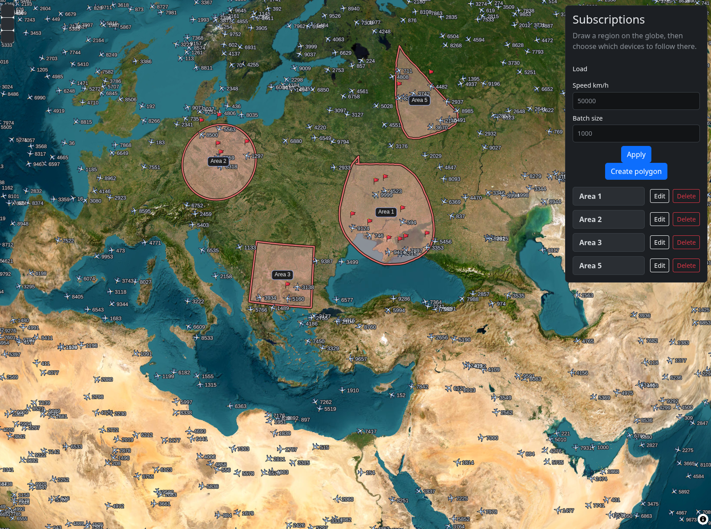
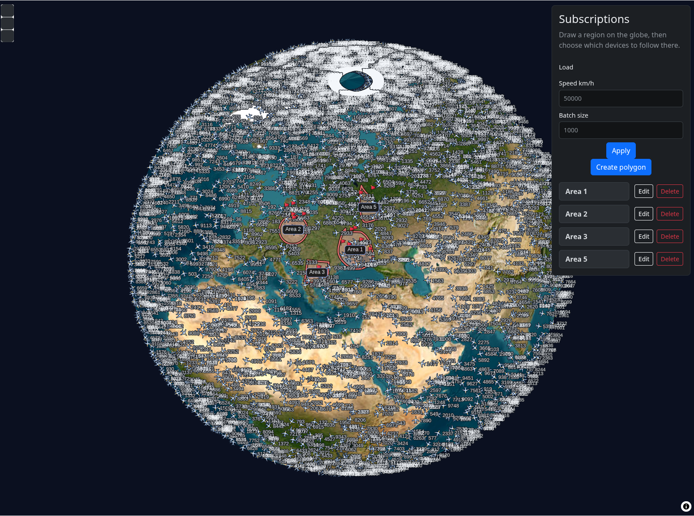

<p align="center">
  
  
</p>

<p align="center">
  <a href="https://github.com/Romanchikus/geo_track/raw/main/docs/screencast.mp4">
    ▶ Watch the screencast
  </a>
</p>

## Run

```bash
docker compose up --build -d
```

UI and API: http://127.0.0.1:5173/login and http://localhost:8080

Stop:

```bash
docker compose down
```

## Generator

`canary_tests/bench_devices.py` starts with the stack as `script-worker`. It publishes 10,000 telemetry messages per second to MQTT.

## Tests

From the repository root:

```bash
uv sync --all-packages --group dev
uv run pytest
```

Pytest uses the project environment, so the `app` package and its dependencies are on the path. Each run creates a temporary SQLite database and deletes it afterward. PostgreSQL does not need to be running. Hourly partitions and PostGIS checks are skipped under SQLite.

Web tests:

```bash
node --test services/web/src
```

## Design

Devices publish protobuf over MQTT. RabbitMQ accepts those publishes and hands them to the telemetry worker. I chose MQTT together with RabbitMQ because that is the right split: devices keep one connection, and the broker absorbs the ingest rate.

Areas are dynamic polygons. I chose that over fixed shapes because arbitrary regions are harder, and that is the implementation I want when the area is not a standard box or radius.

A WebSocket that pushed every point would be too expensive at this volume. The socket sends the id of the latest batch. That batch is already cached in Redis as packed bytes. The client fetches the bytes and decodes them. Decoding stays on the client, which keeps the push small, cuts latency, and leaves the hot path as a cache read.

Live area state is separate from that batch. Connected clients share one coverage polygon, the union of their subscriptions. The socket keeps a device in an area until a newer fix is outside that polygon or the fix is stale. The check is `ST_Covers` on the latest point, so a missed second at 9–11k points/s does not drop the alert. The map marks a device inside an area after the socket confirms it.

## Scale

10,000 connections on FastAPI would make the map process accept the whole device stream. Ingest stays on MQTT. RabbitMQ holds the input and smooths 10,000 messages per second. The API only sees the queue. A separate worker writes the database.

Each process keeps 5 pooled connections and 2 overflow, so 7 at most. The standby worker does not open its pool until it becomes the active consumer.

The worker flushes on a 0.1 s window or 1,000 points and commits once. `COPY` loads a temporary table with no indexes. One `INSERT … SELECT` moves the rows into `telemetry`, which already has the primary key and the GiST index, with `ON CONFLICT DO NOTHING`. The index updates once per batch. A thousand rows in staging take about 0.001–0.01 s. The move into the indexed table is a separate step. Only one stream consumer is active.

`telemetry` is partitioned by hour (`telemetry_YYYYMMDD_HH`). The migration creates the next 24 hours, and a background job repeats that every hour. A query for the last second reads the current partition.

The map does not get each point as its own JSON. Redis stores a binary batch, 20 bytes per point, and the socket sends only that batch id. Several tabs of one user are a set of sockets on the same `user_id`. Areas and arrivals stay scoped to that user. A hit is `ST_Covers` on `geography` in PostGIS, not a check in Python. One FastAPI process merges the polygons of its connected users once, then one query filters points by timestamp and tests that coverage.
